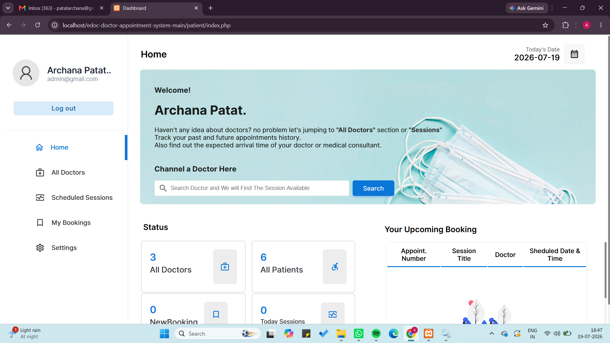
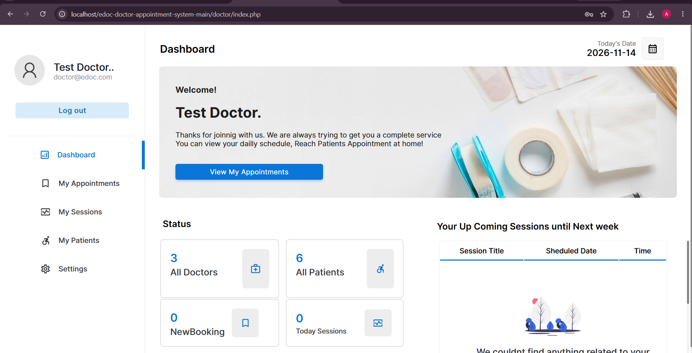
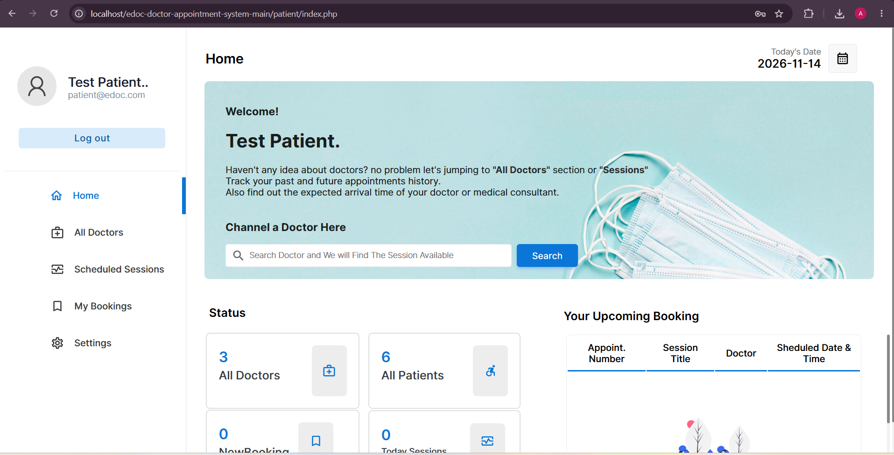

# Doctor Appointment Booking System

## Project Overview

The Doctor Appointment Booking System is a web-based application developed using PHP and MySQL. It allows patients to book appointments with doctors and provides separate dashboards for administrators, doctors, and patients.

The main purpose of this project is to simplify the appointment booking process and manage doctor, patient, and appointment information efficiently.

## Features

### Admin Module
- Admin login
- Manage doctors
- Manage patients
- Manage specialties
- Manage doctor schedules
- View and manage appointments

### Doctor Module
- Doctor login
- View appointments
- Manage appointment schedules
- View patient details

### Patient Module
- Patient registration and login
- View available doctors
- Search doctors by specialty
- Book appointments
- View appointment details

## Technologies Used

| Technology | Purpose |
|---|---|
| PHP | Backend development |
| MySQL | Database management |
| HTML | Web page structure |
| CSS | Styling |
| JavaScript | Client-side functionality |
| Bootstrap | Responsive user interface |
| XAMPP | Local development environment |

## Project Structure

```text
doctor-appointment-booking-system/
│
├── admin/
├── doctor/
├── patient/
├── css/
├── img/
│
├── connection.php
├── create-account.php
├── index.html
├── login.php
├── logout.php
├── signup.php
│
├── SQL_Database_edoc.sql
├── structure.txt
├── SECURITY.md
└── README.md
```

## Installation and Setup

Follow these steps to run the project locally.

### 1. Install XAMPP

Download and install XAMPP on your computer.

### 2. Clone the Repository

```bash
git clone https://github.com/ArchanaPatat/doctor-appointment-booking-system.git
```

### 3. Move Project to XAMPP

Copy the project folder into:

```text
C:\xampp\htdocs\
```

### 4. Start XAMPP

Open XAMPP Control Panel and start:

- Apache
- MySQL

### 5. Create the Database

1. Open `http://localhost/phpmyadmin`
2. Create a database named `edoc`.
3. Select the `edoc` database.
4. Click on the Import tab.
5. Choose `SQL_Database_edoc.sql`.
6. Click Import.

### 6. Configure Database Connection

Open `connection.php` and check the database configuration according to your local MySQL setup.

### 7. Run the Project

Open your browser and visit:

```text
http://localhost/edoc-doctor-appointment-system-main/
```

## Database Information

The project uses MySQL for storing and managing application data.

Main database tables:

- `admin`
- `doctor`
- `patient`
- `specialties`
- `schedule`
- `appointment`
- `webuser`

Database improvements include:

- InnoDB storage engine for all seven tables.
- Primary key relationships.
- Foreign key constraints to maintain referential integrity.
- Cascading rules for related records.

## Screenshots

### Home Page


### Admin Dashboard


### Doctor Dashboard


### Patient Dashboard


## Default Demo Accounts

The following demo credentials are available in the project:

| Role | Email | Password |
|---|---|---|
| Admin | admin@edoc.com | 123 |
| Doctor | doctor@edoc.com | 123 |
| Patient | patient@edoc.com | 123 |

**Note:** These are demo credentials for local testing only. Do not use default credentials in a public production deployment.

## Future Improvements

- Improve application security.
- Implement secure password handling.
- Add additional appointment management features.
- Improve user interface and responsiveness.

## Author

**Archana Patat**

- GitHub: https://github.com/ArchanaPatat

## License

This project is developed for educational and learning purposes.
